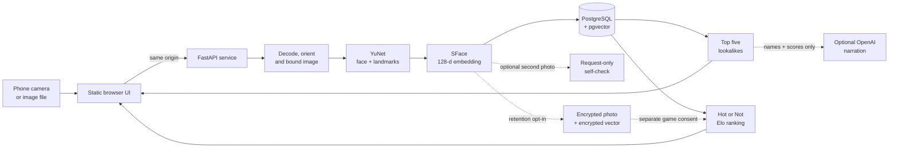

# Double Trouble

> **Find your double. Pick your favorite.**

Double Trouble is a private, invite-only face-matching party app. Take a selfie, see it next to the five pictured people in the reference gallery who look most like you, and then switch to **Hot or Not** to settle the truly important question: which favorite wins the room? A separate two-photo self-similarity tool checks model consistency across lighting when you want it.

The project is also a compact blueprint for running a CPU-only computer-vision product: a same-origin FastAPI application, a replaceable face-model provider, PostgreSQL/pgvector retrieval, consent-aware biometric handling, observable requests, and a promotion path from development to production.

## What is in the box?

- **Camera or file upload:** JPEG, PNG, WebP, HEIC, and HEIF from phones and desktops.
- **Optional two-photo confidence check:** a dedicated sidebar tool compares the same person under different lighting without blocking matching.
- **Pictured lookalike search:** displays the upload beside five unique gallery identities using exact cosine distance over face embeddings.
- **Hot or Not:** pairwise portrait votes feed an Elo leaderboard. Guests join only after separate, revocable retention and game-participation consent.
- **Invite-only access:** revocable server-side sessions, one-time invitations, roles, admin audit events, and a guarded first-admin bootstrap.
- **Privacy by default:** photos and query vectors live only for the request unless the user separately opts into encrypted, expiring retention.
- **Optional narration:** OpenAI can turn candidate names and scores into one playful line without receiving the visitor's photo, vector, email, or account ID.
- **A little theatre:** a spinning search animation, result confetti, and one very specific Ben Affleck easter egg.

## Architecture

The browser UI and API share one origin. The model pipeline is deliberately behind a provider interface, while PostgreSQL owns identities, vectors, sessions, votes, consent records, and audit trails.



### Technology choices

| Area | Choice | Why |
| --- | --- | --- |
| Web | FastAPI, Uvicorn, vanilla HTML/CSS/JS | One small same-origin service; no CORS or frontend build system. |
| Data | PostgreSQL 16, SQLAlchemy, Alembic, pgvector | Transactions for auth/Elo plus vector retrieval in the same database. |
| Detection | OpenCV YuNet 2023mar | Face-specific, CPU-friendly, five landmarks, MIT licensed. |
| Embeddings | OpenCV SFace 2021dec | Aligned 128-dimensional face vectors, CPU-friendly, Apache-2.0. |
| Ranking | Pairwise Elo, initial rating 1500, K=24 | Choosing between two faces is more fun than pretending a 1–10 score is scientific. |
| Auth | Argon2id, opaque hashed tokens, strict cookies | Password hashing and individually revocable sessions/invitations. |
| Operations | Docker, Render Blueprint, GitHub Actions | Reproducible image, startup migrations, health-gated promotion. |

No YOLO model is used. Generic COCO weights do not contain a face class, and the standard Ultralytics code/weight distribution does not meet this project's permissive-license constraint. The provider boundary allows another independently licensed face detector later.

## How matching works

1. The server validates bytes, media type, and pixel count; applies EXIF orientation; converts to RGB; and downsizes in memory.
2. YuNet selects a clear, sufficiently large, central face and returns five landmarks.
3. SFace aligns that face and creates a normalized 128-dimensional vector.
4. pgvector finds the nearest reference sample per identity and returns five unique candidates with authenticated portrait URLs when the gallery was built with cleared portraits.
5. The optional retention path encrypts the normalized image and its vector separately. A second, explicit consent can publish the decrypted portrait to signed-in Hot or Not players until withdrawal or expiry. The default path stores neither.
6. The separate self-similarity tool embeds two request-local photos, returns score/threshold/pass-fail, and retains neither image nor vector.

Similarity is a relative retrieval signal, not proof of identity. Reference provenance, model version, vector dimension, and consent version travel with the relevant records so model changes can be evaluated and rolled out deliberately.

## Hot or Not: ranking for fun

Hot or Not presents two pictured, nearby Elo competitors most of the time and occasionally explores a random pairing. The pool can combine rights-cleared gallery portraits and explicitly consented guest portraits. A vote is written as an immutable event and updates both ratings in one transaction; retrying the same matchup cannot count it twice.

Lookalike similarity and Elo remain separate on purpose: the model answers *“who is nearby in embedding space?”* while the crowd answers *“who wins this matchup?”* Neither is an objective statement about beauty, identity, or worth.

## Run locally

The closest match to the hosted architecture is Docker Compose. It builds the pinned CPU model artifacts, starts PostgreSQL with pgvector, runs Alembic, and serves the app at <http://localhost:8000>.

```sh
docker compose -f compose.dev.yaml up --build
```

The initial database contains no reference gallery, so matching intentionally returns `503` until a reviewed vector bundle is loaded. Gallery preparation is documented in [Gallery MLOps](docs/gallery-mlops.md).

To run directly on the host, install Python 3.12, [uv](https://docs.astral.sh/uv/), Git 2.31 or newer, and PostgreSQL with the `vector` extension. `uv sync` creates the local `.venv` automatically:

```sh
uv sync --locked
cp .env.example .env
uv run python scripts/fetch_models.py --output models
uv run alembic upgrade head
uv run uvicorn app.main:app --reload
```

Set `FACE_MODEL_PATH=models` in `.env`. Local plain HTTP also requires `SESSION_COOKIE_SECURE=false`.

### Run the project checks

```sh
uv lock --check
uv run pre-commit run --all-files
uv run python -m compileall -q app scripts migrations
uv run python scripts/run_unit_tests.py
docker compose -f compose.dev.yaml config --quiet
docker build -t double-trouble .
```

Install the repository hooks once with `uv run pre-commit install --install-hooks`. They run fast lint and security checks before a commit, validate Conventional Commit messages, and run the unit suite before a push. Commitizen is optional for composing a message (`uv run cz commit`); ordinary `git commit` still works when its message follows the convention.

## Project guide

- [Deployment blueprint](docs/deployment.md) — Render environments, secrets, admin bootstrap, health gates, and branch promotion.
- [Gallery MLOps](docs/gallery-mlops.md) — rights gate, LFW vector build, validation, ingestion, and model-version rollout.
- [Data model](docs/data-model.md) — accounts, sessions, invitations, reference vectors, consented uploads, and audit data.
- [Architecture decisions](docs/adr/) — the durable reasoning behind service shape, privacy, auth, observability, CI/CD, models, and gallery delivery.

## Launch status

The local Docker stack and Render-shaped image are operational with the CPU-only YuNet/SFace pipeline, migrations, auth, consent controls, tracing, and health checks. Matching remains fail-closed when disabled, when models are unavailable, or while the gallery is empty.

Before a wider launch, the operator still needs to complete the reference-data rights review, ingest a version-matched vector gallery, calibrate self-similarity thresholds on rights-cleared evaluation pairs, benchmark CPU latency and memory on the chosen Render plan, and review biometric-data retention obligations. The current design is a private noncommercial PoC blueprint, not a claim that LFW images may be redistributed or that a free hosting tier is production durability.
